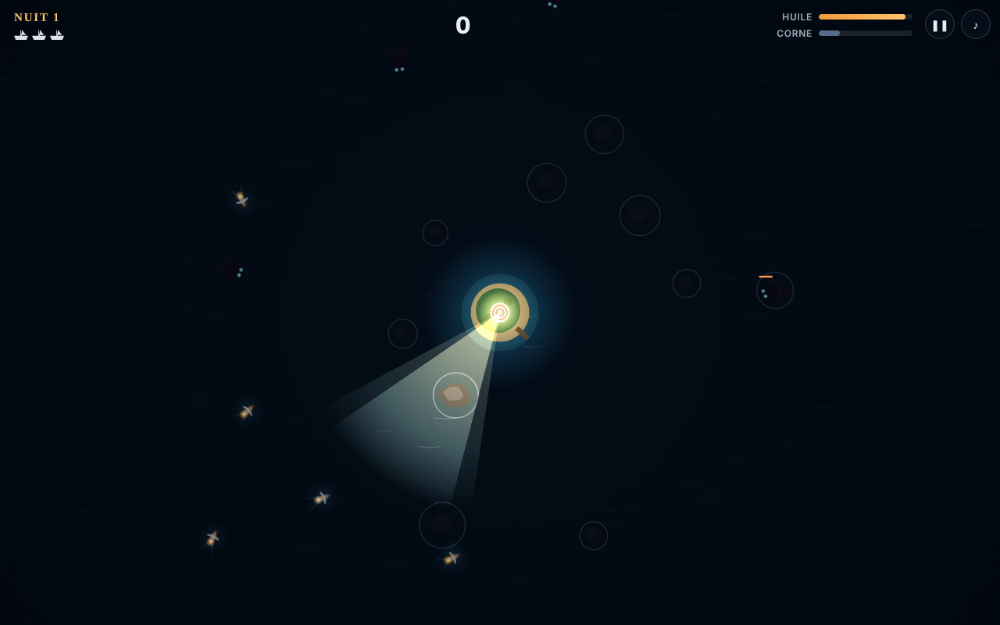

# Tide Keeper

> *La brume est tombée sur l'archipel. Tu es le dernier gardien du phare.*

**Tide Keeper** est un petit jeu d'arcade / survie jouable dans le navigateur. Tu contrôles le faisceau d'un phare au centre d'une île : guide les navires perdus jusqu'au port, brûle les créatures qui remontent des abysses, et gère ton huile pour que la flamme ne s'éteigne jamais.



## Lancer le jeu

Aucune installation, aucune dépendance : ouvre `index.html` dans un navigateur.

Pour un serveur local (recommandé, pour les polices) :

```bash
python3 -m http.server 8000
# puis http://localhost:8000
```

Le jeu fonctionne aussi tel quel sur **GitHub Pages** (Settings → Pages → branche `main`, dossier `/`).

## Comment jouer

| Action | Souris / clavier | Tactile |
|---|---|---|
| Orienter le faisceau | Déplacer la souris · `←` `→` | Glisser le doigt |
| Focaliser (plus loin, plus fort, consomme plus) | Clic maintenu · `Espace` | Bouton **Focaliser** ou deux doigts |
| Corne de brume (repousse et étourdit les créatures) | Clic droit · `F` | Bouton **Corne** |
| Pause / son | `P` · `M` | Boutons en haut à droite |

### Règles

- **Navires** : dans le noir, ils approchent en spirale au hasard et finissent souvent sur les récifs. Un navire **éclairé** suit ta lumière et contourne les rochers jusqu'au port (+100 points, +15 huile).
- **Créatures** : elles foncent vers l'île et coulent les navires qu'elles croisent. La lumière les ralentit et les brûle ; le faisceau focalisé les détruit vite mais vide ton réservoir.
- **Huile** : le faisceau en consomme en permanence. Sans huile, il ne reste qu'une faible lueur. Les navires à quai et les **barils** repêchés (éclaire-les pour les attirer) remplissent le réservoir.
- **Vies** : chaque naufrage ou créature qui atteint l'île coûte une vie.
- **Série** : enchaîne les navires sauvés sans perte pour un multiplicateur jusqu'à ×4.
- **Aube** : chaque nuit survécue rapporte un bonus (doublé si aucun naufrage) et te laisse choisir une amélioration parmi trois.

### Créatures

| Créature | Apparaît | Particularité |
|---|---|---|
| Rampant (yeux cyan) | Nuit 1 | Équilibré |
| Anguille (yeux rouges) | Nuit 3 | Rapide, fragile |
| Léviathan (trois yeux ambre) | Nuit 5 | Lent, très résistant |

### Améliorations

Lentille de Fresnel (faisceau plus large), Miroir poli (portée), Cristal ardent (dégâts), Grand réservoir, Mèche économe, Charpentier du port (+1 vie), Corne de bronze (recharge), Pilote du port (navires guidés plus vite).

## Structure

```
index.html      interface (titre, HUD, aube, fin de partie)
style.css       styles
src/game.js     moteur du jeu : monde, entités, faisceau, rendu Canvas 2D
src/audio.js    sons synthétisés en Web Audio (aucun fichier audio)
```

Tout est en JavaScript pur, sans build. Le rendu repose sur un calque d'obscurité dans lequel le faisceau et le halo du phare sont « découpés » (`destination-out`), puis une lueur additive par-dessus.

## Idées pour la suite

- Tempêtes qui déplacent les récifs, éclairs qui révèlent la carte
- Navires spéciaux (marchands à escorter, pirates qui éteignent le phare)
- Classement en ligne, mode infini, mode quotidien avec graine fixe
- Version PWA installable sur téléphone

## Licence

MIT — voir [LICENSE](LICENSE).
